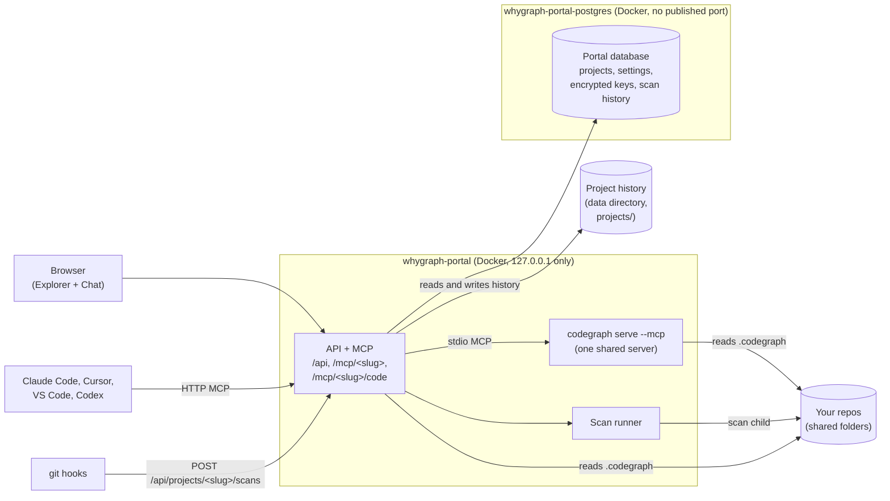

# The portal

The portal is WhyGraph's front door. It is **one long-running server** that holds all your projects,
shows each one in the Explorer and the Chat assistant, runs every scan, and serves each project's
evidence and rationale to your coding agents over HTTP MCP at `/mcp/<slug>`.

You start it once with `whygraph up`, open it in a browser, and add repositories from the Projects
page - a folder you share, or a checkout you link to a project on a team's
[platform](platform-projects.md). There is no per-repo setup command: the portal does what `whygraph init` used to do, with a
preview of every file it will touch.

## What lives where

| Thing | Where |
|---|---|
| Portal settings, project list, API keys and GitHub tokens (encrypted), scan history | The portal database: Postgres in the `whygraph-portal-postgres` container, its files in `postgres/` under the portal's data directory, `~/.local/share/whygraph` on your host |
| The encryption key for those keys and tokens, and database backups | The data directory, as `secret.key` and `backups/` |
| The [usage ledger](usage.md): one row per LLM call (counts, cost, model, who and which project - never prompt or chat text), budgets, and price overrides | The portal database, kept 400 days |
| [Agent activity](agents.md#agent-activity): how many MCP and connected-machine calls each project got per day, by call name and caller, plus Chat tool calls by name - counts only | The portal database, kept 400 days |
| A project's evidence, descriptions, rationale cache and chat history | The portal's data directory, in `projects/<org>/<slug>/whygraph.db` (`projects/local/<slug>/` in local mode), beside a small `project.json` that says which repository it belongs to |
| A project's CodeGraph index | The repository itself, in `.codegraph/` |
| A [platform project](platform-projects.md)'s history, descriptions and rationale | The platform, never your machine. Your portal keeps only the link: the platform's address, the project's name and a **connection token**, encrypted |
| The hosted CodeGraph server | One `codegraph serve --mcp` process inside the portal container, shared by every project: about 130-300 MiB while it runs, stopped after 10 idle minutes and started again by the next call |
| The folders, port and image the portal was started with | `~/.config/whygraph` on your host |

A project's history lives in the data directory, not in the repository, so `git clean -xdf`, a fresh
clone or a moved checkout does not lose it. Removing a project keeps its history in local mode (unless
you tick **Also delete history**) and deletes it in production (unless you tick **Keep history**), and
adding the same repository again re-attaches what was kept; see [Adding projects](projects.md). A
`.whygraph/whygraph.db` that an earlier release left in a repository is not read; see
[Upgrading](upgrading.md). Back up the **whole data directory**, which holds both the portal database
and the project history; see [Backup and restore](backup.md).

## Where to next

-   :material-play-circle-outline:{ .lg .middle } __Start the portal__

    ---

    `whygraph up`, the first-run setup, and the other host commands.

    [:octicons-arrow-right-24: Start the portal](start.md)

-   :material-folder-network-outline:{ .lg .middle } __Shared folders__

    ---

    The portal runs in Docker and only sees the folders you share with it.

    [:octicons-arrow-right-24: Shared folders](shared-folders.md)

-   :material-source-repository:{ .lg .middle } __Adding projects__

    ---

    A repository from a shared folder, configure, initialize, first scan.

    [:octicons-arrow-right-24: Adding projects](projects.md)

-   :material-lan-connect:{ .lg .middle } __Projects from a platform__

    ---

    Link a checkout to a team's WhyGraph so your agent reads its history, and your own changes stay local.

    [:octicons-arrow-right-24: Projects from a platform](platform-projects.md)

-   :material-connection:{ .lg .middle } __Connecting agents__

    ---

    The MCP entry each agent gets, and what to know about ports and approval prompts.

    [:octicons-arrow-right-24: Connecting agents](agents.md)

-   :material-cash-multiple:{ .lg .middle } __Usage & cost__

    ---

    What your LLM calls cost, per project, model and member, and the budgets that cap them.

    [:octicons-arrow-right-24: Usage & cost](usage.md)

-   :material-shield-lock-outline:{ .lg .middle } __Security model__

    ---

    Loopback only, where keys live, and what the portal will not do to your repo.

    [:octicons-arrow-right-24: Security model](security.md)

-   :material-database-arrow-down-outline:{ .lg .middle } __Backup and restore__

    ---

    `whygraph backup`, the automatic dump before an upgrade, and how to restore.

    [:octicons-arrow-right-24: Backup and restore](backup.md)

-   :material-update:{ .lg .middle } __Upgrading__

    ---

    From 1.x, add your repos like new ones.

    [:octicons-arrow-right-24: Upgrading](upgrading.md)

